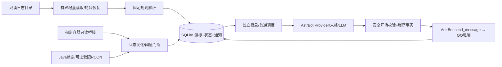

# 架构与API依据

## 模块职责

| 文件 | 职责 |
| --- | --- |
| `main.py` | `Star` 生命周期，四个可取消任务，管理员绑定/测试/状态/重载命令 |
| `_conf_schema.json` | AstrBot 原生配置界面，同时作为插件默认值唯一来源 |
| `config.py` | 合并默认值，类型/范围/UMO/时区/地址校验，拒绝错误配置且不回显值 |
| `models.py` | 结构化事件、固定来源指纹、UTC采样时间 |
| `storage.py` | 序列化异步SQLite事务，事件去重、持久队列、游标与状态原子提交 |
| `tailer.py` | 有界二进制读取，inode/内容指纹，截断、轮转、gzip恢复 |
| `parser.py` | 常见英文Vanilla/Paper日志；聊天过滤；真实UUID缓存；在线状态可信度 |
| `probes.py` | aiohttp只读桥接、Java SLP、asyncio RCON framing及固定输出格式解析 |
| `engine.py` | 采集健康、状态边沿、异常/恢复连续次数、迟滞及持久化 |
| `notifier.py` | 紧急/普通独立队列、按接收者重试、合并、安静时段、人格化开场与模板回退 |
| `tools/docker_readonly_bridge.py` | 宿主指定容器的过滤GET接口，不返回Config.Env等inspect私密信息 |
| `tools/build_package.py` | 白名单打包并复核根目录结构、源代码、Schema和排除项 |
| `tools/check_astrbot_compat.py` | 在新建隔离目录加载4.29.1官方源码，使用真实宿主API和内存传输验证兼容性 |

所有网络操作用asyncio/aiohttp并设超时；文件日志与SQLite操作在worker线程执行。SQLite操作取消时等待在途事务完成后释放锁，避免事务与下一任务交错。日志读取取消时等待只读worker收尾。任务退出后关闭HTTP session，RCON/SLP在finally关闭TCP writer。配置文件在worker读取；默认Schema只读缓存。

日志解析错误不停止后续监控；持续采集失败形成一次故障状态，恢复后通知。队列写入失败不提前提交游标。已处理事件默认保留14天，定期清理去重记录与过期冷却；未送达记录不会因保留期自动删除。快速重试耗尽转入有上限的长期重试间隔，避免瞬时错误造成永久丢失。

## 官方API核对

2026-10-11 开发时读取当前官方文档和AstrBot `master`相关源码；这是接口核对日期，不是对未来或所有4.x版本的运行保证。

2026-10-19适配时重新核对[AstrBot v4.29.1](https://github.com/AstrBotDevs/AstrBot/tree/dffe922773725e9c178392c423676ad65044748c)。LLM、主动发送、UMO、配置注入及生命周期接口继续可用；留空人格改用该版本的[PersonaManager.resolve_selected_persona](https://github.com/AstrBotDevs/AstrBot/blob/v4.29.1/astrbot/core/persona_mgr.py)，遵循会话规则优先级。显式人格使用宿主v3查询（含内置默认人格），旧宿主无此接口时保留原API路径。最近上下文提取分段消息中的text部分，再创建官方消息类型，不传入工具、思考或媒体。

| 用途 | 核实接口 | 官方来源 |
| --- | --- | --- |
| 插件激活/停用 | `async initialize()` / `async terminate()` | [Star源码](https://github.com/AstrBotDevs/AstrBot/blob/master/astrbot/core/star/base.py) |
| 当前Provider | `await context.get_current_chat_provider_id(umo=target)` | [AI文档](https://docs.astrbot.app/dev/star/guides/ai.html) |
| 直接LLM生成 | `await context.llm_generate(chat_provider_id=..., prompt=..., system_prompt=..., contexts=..., tools=None)` | [Context源码](https://github.com/AstrBotDevs/AstrBot/blob/master/astrbot/core/star/context.py) |
| 主动发送 | `await context.send_message(umo, MessageChain().message(text))`；False表示未找到平台 | [消息文档](https://docs.astrbot.app/dev/star/guides/send-message.html) / Context源码 |
| UMO | `event.unified_msg_origin`；平台实例ID、消息类型、session ID | [会话源码](https://github.com/AstrBotDevs/AstrBot/blob/master/astrbot/core/platform/message_session.py) |
| 对话读取 | `get_curr_conversation_id` / `get_conversation`，仅读取已有对话 | [AI文档](https://docs.astrbot.app/dev/star/guides/ai.html) |
| 人格 | `await persona_manager.get_persona(id)` / `get_default_persona_v3(umo=...)` | [人格源码](https://github.com/AstrBotDevs/AstrBot/blob/master/astrbot/core/persona_mgr.py) |
| 最近文本上下文 | `UserMessageSegment` / `AssistantMessageSegment` / `TextPart` | [消息类型源码](https://github.com/AstrBotDevs/AstrBot/blob/master/astrbot/core/agent/message.py) |
| 配置 | `AstrBotConfig` dict、`config_path`、原生object/list与Provider/人格选择器 | [配置文档](https://docs.astrbot.app/dev/star/guides/plugin-config.html) / [配置源码](https://github.com/AstrBotDevs/AstrBot/blob/master/astrbot/core/config/astrbot_config.py) |
| 数据路径 | `get_astrbot_data_path()/plugin_data/插件名` | [存储文档](https://docs.astrbot.app/dev/star/guides/storage.html) |

不用Agent工具循环、不注册LLM工具、不添加对话记录。角色语气来自人格和可选只读上下文；输出受安全句式约束，生成内容不能改写权威事实。

Docker部署依据：[Docker daemon安全说明](https://docs.docker.com/engine/security/protect-access/)、[Engine API参考](https://docs.docker.com/reference/api/engine/)。Paper命令能力参考：[Paper命令文档](https://docs.papermc.io/paper/reference/commands/)。RCON/TPS/MSPT解析针对受支持的实际文本格式，协议隔离测试不等同于真实服务端兼容验证。
